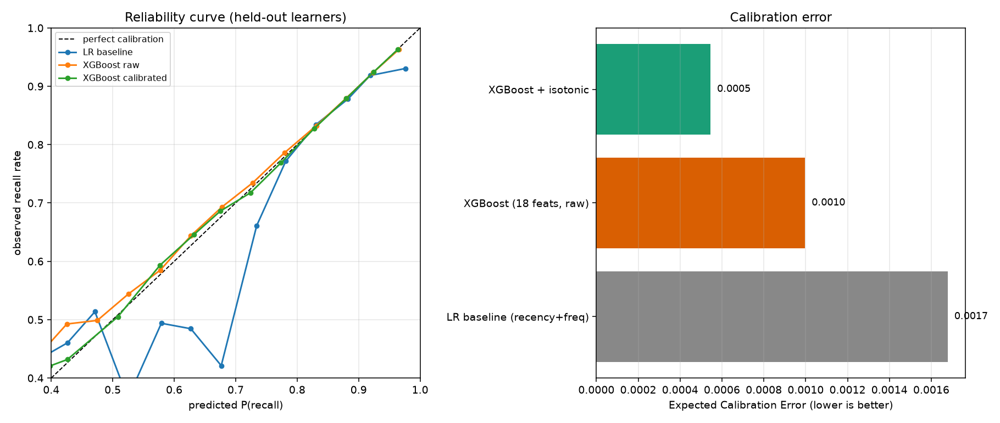

# Recall Prediction for Spaced Repetition

Predicting the probability that a learner correctly recalls a vocabulary item on
their next review, from their review history. The output is a **calibrated
probability**, because the consumer is a scheduler: it decides when to next show
an item by asking when recall probability decays to a target retention. A
ranking is not enough — the number itself has to be true.

Built on Duolingo's [Half-Life Regression](https://github.com/duolingo/halflife-regression)
dataset (12.85M learner-item interaction logs, released with their 2016 ACL paper).

## Results

Evaluated on **23,218 held-out learners** (4.75M trials) who appear in no other split.

| Model | AUC | Brier | Log loss | ECE |
|---|---|---|---|---|
| Logistic regression (recency + frequency) | 0.5833 | 0.08659 | 0.31392 | 0.00168 |
| XGBoost (18 features) | 0.6517 | 0.08448 | 0.30367 | 0.00100 |
| XGBoost + isotonic calibration | 0.6516 | 0.08447 | 0.30358 | 0.00055 |



The base rate is 90.45% recall, so accuracy is a useless metric here — always
predicting "correct" beats any model on it. AUC and calibration are reported
instead.

### What the numbers say

**The engineered features are what scale.** Prototyping on a 482K-row sample and
then running on all 12.85M rows, XGBoost gained +0.040 AUC (0.6119 → 0.6517)
while the baseline stayed flat (0.5849 → 0.5833). Recency and frequency features
are fully determined per row and gain nothing from more data; `lexeme_difficulty`
and `user_ability` are estimated quantities and got 27× more data to estimate
from. The ablation gap widened from +0.027 to +0.068.

**Miscalibration was mostly a small-data artifact.** Raw XGBoost ECE was 0.01176
on the sample and 0.00100 on the full data — 12× better from data alone. The
isotonic layer still halves what remains (0.00055) and leaves AUC unchanged to
within isotonic's own tie-breaking (0.6517 → 0.6516), since a monotonic transform
cannot reorder predictions. It is worth keeping, but it is not what makes the
model work.

**Top features by gain:** `user_ability` (0.319), `lexeme_difficulty` (0.254),
`history_rate` (0.088), `decay_h7` (0.053).

## Modeling decisions

**The label is a proportion, not a bit.** Each source row is an aggregated
*session*: `p_recall` with `session_seen` trials and `session_correct` successes.
Only 59% of rows are single-trial. Rather than thresholding (which discards trial
counts and lets session length contaminate the label), each row is expanded into
at most two weighted rows — `(y=1, w=session_correct)` and
`(y=0, w=session_seen-session_correct)` — an exact Bernoulli-trial
representation. This yields 23.4M trials from 12.85M rows and keeps predictions
on the per-review scale a scheduler consumes.

**Splits hold out whole learners.** Every feature is a per-learner window, so
splitting on rows would put the same learner's history on both sides. Splitting
by `user_id` supports the claim that the model generalises to learners absent
from training. Note the honest scope limit: this dataset contains **no first
exposures** (every row has `history_seen >= 1`), so "unseen learner" does not
mean "cold start with no history."

**Four splits, all by user:** `train/fit` (model), `train/val` (early stopping),
`calib` (isotonic only), `test` (reported numbers only). The calibration set is
kept separate from the early-stopping set so the calibrator never sees data the
model was tuned against.

### Leakage control

A row-based window (`rowsBetween`) silently leaked: **99.7% of rows share a
timestamp with another row of the same user**, because one session reviews many
items at a single instant, so item *N* of a session could see the outcomes of
items 1..*N*−1 of that same session — information unavailable at scheduling time,
when every item is scored before any is answered. All learner and streak features
use `rangeBetween` over the timestamp instead, admitting only strictly earlier
sessions. This produced no error and no NaN; it surfaced only by asserting that
`user_prior_trials` is constant within a session.

Lexeme target encoding is fit on training users only, smoothed toward the global
prior. ~10% of test lexemes never appear in training, so the fallback is required.

## Pipeline

```
data/raw/*.csv.gz          379MB gzip — NOT splittable, Spark reads it in 1 task
  -> src/features/ingest.py           explicit schema, repartition by user_id
data/processed/traces.parquet         160MB, splittable, 28 cores usable
  -> src/features/build_features.py   18 features, leak-free windows
data/processed/features_*.parquet
  -> src/models/train.py              baseline, XGBoost, isotonic, metrics, plots
reports/
```

## Setup

Requires **Python 3.12** (PySpark 4.x is not tested on 3.13+) and a **JDK 17 or
21 — not 26**, which removed `jdk.internal.ref.Cleaner`, a class Spark's
off-heap memory layer depends on. `src/spark_session.py` looks for a JDK in
`.jdk/`, then `/usr/lib/jvm/java-21-openjdk`, then 17.

```bash
uv venv --python 3.12 .venv
VIRTUAL_ENV=.venv uv pip install -r requirements.txt

# Duolingo HLR dataset (379MB)
curl -L -o data/raw/learning_traces.13m.csv.gz \
  https://s3.amazonaws.com/duolingo-papers/publications/settles.acl16.learning_traces.13m.csv.gz

.venv/bin/python src/features/ingest.py
.venv/bin/python src/features/build_features.py          # 482K-row sample
.venv/bin/python src/features/build_features.py --full   # all 12.85M rows
.venv/bin/python src/models/train.py features_user_full.parquet
```

## Layout

```
src/spark_session.py          local-mode Spark config (JDK pinning, spill dir)
src/features/splits.py        hash-based user sampling + train/calib/test splits
src/features/ingest.py        CSV.gz -> Parquet
src/features/build_features.py  recency / frequency / item / learner features
src/models/train.py           baseline + XGBoost + isotonic calibration
src/evaluate/metrics.py       trial-weighted AUC, Brier, log loss, ECE
```

## Next

- Parse `lexeme_string` (`mann/mann<n><m><sg><nom>`) into part-of-speech, case,
  gender and number features — currently discarded entirely.
- Report a time-based split alongside the by-learner split, to separate
  generalisation to new learners from generalisation forward in time.
